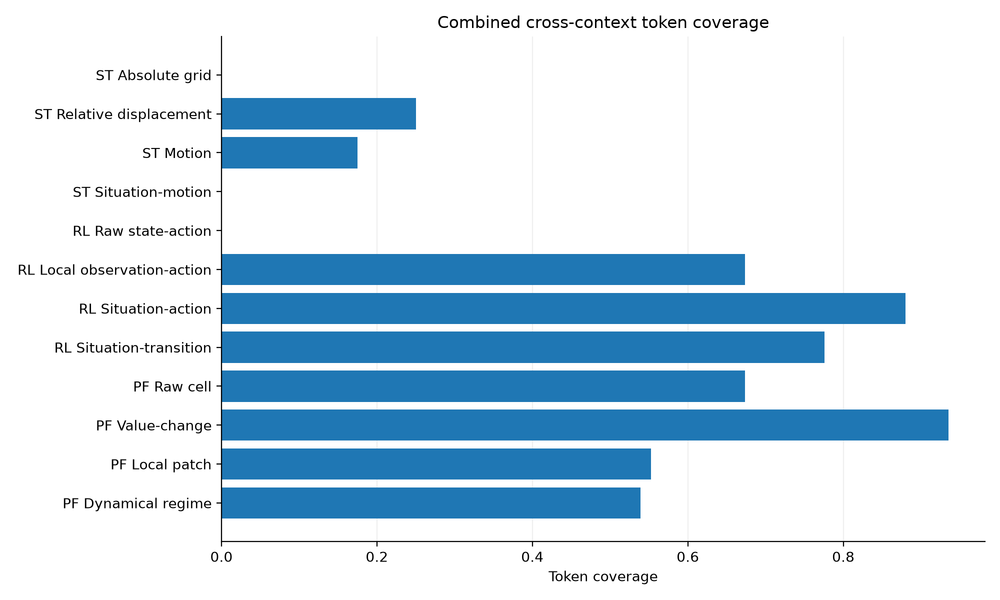

# MotifShift

**Synthetic experiments for understanding what representations reuse across contexts.**

MotifShift compares token representations across generated trajectories, gridworld
replay, and scalar physical fields. It measures recurring units, distribution shift,
sequence recombination, and prediction on held-out contexts. A single command
produces numerical results, comparison tables, figures, and a verifiable run manifest.

The suite is designed for inspecting representation choices with small, reproducible
experiments. Its synthetic tasks illustrate specific mechanisms; they do not establish
performance on real trajectory forecasting, learned RL policies, or weather prediction.

## What it includes

| Domain | Representations | Held-out task |
| --- | --- | --- |
| Trajectories | Absolute position, displacement, motion, motion with local crowding | Predict the next displacement in an unseen scene |
| Gridworld replay | State–action, local observation–action, situation–action, situation transitions | Predict the next token in an unseen layout |
| Scalar fields | Cell coordinates, value/change, local patches, dynamical regimes | Predict the next scalar value in an unseen environment |

- Leave-one-context-out evaluation with training-only predictor fitting.
- Token coverage, vocabulary entropy, Jensen–Shannon divergence, and sequence diagnostics.
- Seed-level results and optional multi-seed mean/standard-deviation summaries.
- Local synthetic data generation; no dataset downloads, API keys, or GPU required.

## Quick start

Use **Python 3.11+**. From the repository root, install the locked environment with
[uv](https://docs.astral.sh/uv/getting-started/installation/):

```bash
git clone https://github.com/asguinea/motifshift.git
cd motifshift
uv sync --locked
uv run --locked motifshift --config configs/quick.yaml
uv run --locked motifshift-verify --outputs outputs/quick --strict
```

The quick configuration runs all three domains. Start with
`outputs/quick/reports/results_summary.md`, then inspect
`outputs/quick/tables/table_combined_diagnostics.csv` and
`outputs/quick/tables/table_combined_transfer.csv`.

For pip, use a virtual environment and the generated, hashed dependency export:

```bash
python -m venv .venv
source .venv/bin/activate
python -m pip install --require-hashes -r requirements.txt
python -m pip install --no-deps .
motifshift --config configs/quick.yaml
motifshift-verify --outputs outputs/quick --strict
```

On Windows, activate with `.venv\Scripts\Activate.ps1` in PowerShell.
`python -m motifshift.run_all` and `python -m motifshift.verify_outputs` are equivalent
module entry points. Commands below use uv to keep dependency versions fixed.

## Run configurations

| Configuration | Purpose | Default output directory |
| --- | --- | --- |
| `configs/smoke.yaml` | Check configuration, CLI, and reporting; runs no domain experiments | `outputs/smoke` |
| `configs/quick.yaml` | Small experiment exercising all domains | `outputs/quick` |
| `configs/default.yaml` | Larger experiment across all domains | `outputs/default` |

```bash
# Check settings without creating outputs.
uv run --locked motifshift --config configs/default.yaml --dry-run

# Generate the full single-seed results.
uv run --locked motifshift --config configs/default.yaml
uv run --locked motifshift-verify --outputs outputs/default --strict

# Run the configured five-seed study in a separate output directory.
uv run --locked motifshift --config configs/default.yaml --robustness --outputs outputs/multiseed
uv run --locked motifshift-verify --outputs outputs/multiseed --include-robustness --strict
```

Each run requires a fresh output directory, preventing stale artifacts from being
mixed with new results. Choose a different `--outputs` path to run again. Output
paths are relative to the current working directory. Edit a copy of a YAML config
to change the seed, generator sizes, enabled domains, or diagnostic settings.

## Reading the results



This example is generated by `configs/quick.yaml`, seed 123. High token coverage
means that held-out observations reuse training tokens. It can also result from
coarse tokenization that discards predictive information. Interpret it alongside
prediction error and the full numerical results, rather than as a quality score.
Raw gridworld tokens contain layout IDs, so their held-out coverage is zero by
construction. Next-token accuracies across different vocabularies also have different
target difficulty and are not directly comparable model rankings.

| Artifact | Contents |
| --- | --- |
| `reports/results_summary.md` | Overview of generated results and interpretation notes |
| `reports/run_summary.md` | Settings, environment, and artifact list |
| `data/*_results.json` | Numerical diagnostics, held-out-context results, and aggregates |
| `tables/*.csv`, `tables/*.tex` | Rounded tables for inspection and reuse |
| `figures/*.png`, `figures/*.pdf` | Comparison plots |
| `data/config.json` | Portable configuration snapshot |
| `data/combined_results_manifest.json` | Package versions, source/config fingerprints, file inventory, and SHA-256 checksums |
| `robustness/seed_*/` | Individual seed outputs when robustness is enabled |

`--strict` validates the manifest and recorded files, checks configuration consistency,
and detects modified artifacts. Without it, verification only checks a fixed set of
full-run files for presence and nonzero size. Checksums detect changes; they are not
digital signatures or independent verification of scientific conclusions.

## Methodology and reproducibility

Read [the experimental protocol and limitations](docs/methodology.md) and
[the reproduction guide](docs/reproducibility.md) before interpreting results.
The data generators, token definitions, and simple predictors are deliberately
inspectable. Numerical JSON retains precision; CSV/LaTeX displays rounded values.

Sequence metrics preserve independent trajectory, episode, and cell histories.
Physical-field prediction uses previous observed changes; descriptive diagnostics
may use complete transitions. Standard deviations use `ddof=0` and summarize
variation across held-out contexts or across seed-level means, as labeled.
They are not confidence intervals, and overlapping training folds are not independent.

## Development

```bash
uv run --locked pytest
uv run --locked ruff check .
uv run --locked ruff format --check .
uv run --locked python -m build --no-isolation
```

CI is configured for Python 3.11 and 3.13 on Linux, plus Python 3.13 on macOS and
Windows. It checks formatting, tests, coverage, a quick multi-seed run, output
integrity, and package builds. See [CONTRIBUTING.md](CONTRIBUTING.md).

## Citation and license

Use [CITATION.cff](CITATION.cff) to cite the software. Record the exact version or
commit and configuration used for an experiment.

Copyright 2026 Alejandro Sánchez Guinea. Distributed under [Apache-2.0](LICENSE).
Dependencies retain their own licenses.
